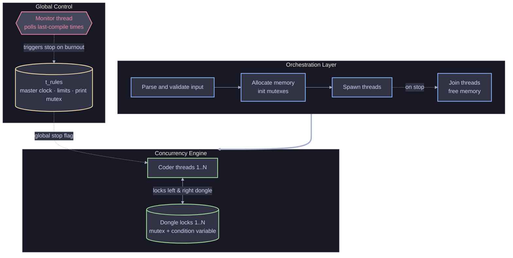

# Codexion

> A multithreaded C simulation where independent threads compete for shared resources without ever deadlocking or starving — a brutal spin on the Dining Philosophers problem, built to orchestrate concurrency under strict deadline pressure.

*Built as part of the 42 curriculum.*

---

## The Problem

Picture five coders around a circular table in a loud co-working space. In the center sits a powerful Quantum Compiler, but to use it a coder has to plug in **two USB dongles at once** — the one to their left and the one to their right. There are only five dongles on the table. And if a coder goes too long without compiling, they burn out from frustration and the whole simulation halts instantly.

Underneath the metaphor this is the classic concurrency problem: independent threads contending for shared resources, where a single coordination mistake means the entire system freezes or a thread silently dies. The real problem Codexion solves is orchestration — taking isolated, chaotic moving pieces and defining the boundaries that let them run in parallel and just *work*.

I'm obsessed with that exact moment. So before writing a single line of code, I designed this architecture on paper. If the foundation is flawed, the threads collapse under pressure. If the boundaries are right, true concurrency emerges effortlessly.

---

## How It Works

You define the constraints at launch — how many coders, how long until burnout, how long compiling and debugging take. Each coder spawns as a fully independent thread and tries to survive the gauntlet. Hit the required number of compiles and everyone goes home; introduce a bottleneck and someone eventually starves, at which point a dedicated monitor thread catches it and shuts the simulation down cleanly.

Each coder cycles through a fixed state loop:

```
┌───────────┐      ┌──────────────┐      ┌───────────────┐
│ Thinking  │─────▶│ Borrow Left  │─────▶│  Compiling    │
│           │      │ & Right Keys │      │ (Holding both)│
└───────────┘      └──────────────┘      └───────────────┘
      ▲                                          │
      │                                          ▼
┌───────────┐                            ┌───────────────┐
│Refactoring│◀───────────────────────────│  Debugging    │
│           │   (Dongles returned to     │               │
└───────────┘    table & on cooldown)    └───────────────┘
```

---

## Architecture

I split the system into three boundaries on paper before coding: an **orchestration layer** that handles setup and teardown, a **global control layer** holding shared read-only state and the monitor, and the **concurrency engine** where the actual coder threads and dongle locks live. Keeping these strictly separated is the whole game — it means each thread only ever touches the resources it's explicitly responsible for.



| Component | Role | Mechanism |
|-----------|------|-----------|
| `t_rules` | Read-only global state + console lock | shared struct, single print mutex |
| `t_coder` | Per-thread state, isolated | flat heap array, one struct per thread |
| `t_dongle` | Shared resource, one per coder | mutex + condition variable |
| Monitor | Burnout detection | independent polling thread |

**Three decisions shaped this, each chosen over an obvious alternative:**

**State isolation over one big shared struct.** Rather than threading a single massive context through everything, `t_rules` holds only read-only global data plus the print lock, while `t_coder` holds only that thread's own state. This keeps lock scope minimal — a thread never has to acquire a resource it doesn't actually need to read or write.

**Flat arrays over linked lists.** Coders and dongles are allocated as flat heap arrays at runtime. This gives O(1) random access, which matters because the monitor thread sweeps the entire coder array every couple of milliseconds — pointer-chasing through a linked list on every sweep would add overhead exactly where the system is most time-sensitive.

**A pre-calculated circular map over runtime lookups.** Coders don't compute which dongles are theirs during the simulation. At init, each coder receives direct pointers to its left dongle (`dongles[i]`) and right dongle (`dongles[(i+1) % N]`). The routing is solved once upfront so the hot loop spends zero cycles figuring out who owns what.

---

## The Hard Parts

You can't drop `while(1)` into five threads and hope. A naive loop freezes or crashes in milliseconds. Four problems had to be solved deliberately.

### The Deadlock Dance

All five coders reach for their left dongle at the same instant. Each grabs one. Now each turns for their right dongle — and their neighbor is holding it. Nobody can compile, nobody will let go. The program freezes forever.

The fix is asymmetry. Even-numbered coders grab their *right* dongle first, odd-numbered coders grab their *left*. That mechanically guarantees at least one coder secures both dongles, breaking the circular-wait condition that deadlock depends on.

### Melting the CPU vs. Going to Sleep

A coder waiting on a dongle could just spin — `while(!available);` — but that pins a core at 100% and drags the whole machine down. Instead, waiting coders sleep on a POSIX condition variable (`pthread_cond_wait`), freeing the CPU entirely. When a neighbor drops a dongle, it broadcasts a wake signal. Because the OS occasionally wakes threads for no reason (spurious wakeups), the sleep sits inside a strict `while`-loop condition check so a thread that wakes early simply goes back to sleep.

### C Has No Priority Queue

The simulation needs two schedulers for the dongle waiting rooms: FIFO (first arrival wins) and EDF (earliest deadline first — the coder closest to burning out wins). C ships no priority queue, so I built a min-heap from scratch. When several coders wake for a freed dongle, the heap selects the single most desperate one; the rest go straight back to sleep.

### The Grim Reaper

A thread asleep on a lock can't track its own burnout deadline — it's asleep. So a dedicated monitor thread does nothing but poll the coder array every few milliseconds, comparing current time against each coder's last-compile time. The instant a gap exceeds the limit, it sets the global stop flag and shuts the simulation down within a tight window.

---

## What I'd Do Differently

- Swap `gettimeofday` for `CLOCK_MONOTONIC`. The current clock can drift if the host OS syncs its system time mid-run; a monotonic clock would make timing bulletproof regardless of what the OS does underneath.
- Make the scheduler pluggable rather than compile-time selected, so FIFO and EDF could be swapped or compared at runtime.

---

## Stack & Links

| | |
|---|---|
| Language | C |
| Concurrency | POSIX threads, mutexes, condition variables |
| Data structures | Min-heap (hand-rolled), flat heap arrays |
| Validation | Valgrind, ThreadSanitizer (`-fsanitize=thread`) |
| Source | [GitHub](#) |

---

## Numbers

*Verify each of these against your actual measurements before publishing — note how the timing ones were measured.*

- **Burnout precision:** deadlines caught and reported within ~2ms on average.
- **Memory safety:** clean Valgrind teardown, `0 bytes in 0 blocks` lost.
- **Race-condition immunity:** compiles and runs clean under ThreadSanitizer with no detected data races.
