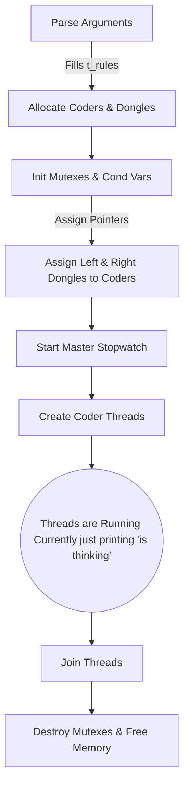
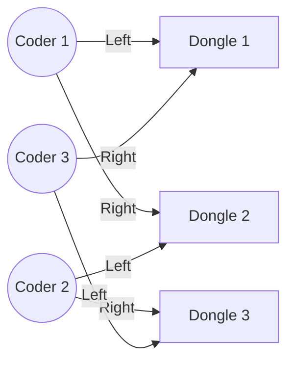

# 🧠 Codexion - Project Roadmap & State

## 📍 Where We Stand Right Now
Phase 1 (Architecture & Setup) is **100% COMPLETE**. 
You have successfully built a leak-free foundation where threads are born safely, they know who they are, they have their tools, and they die cleanly.

### 🏗️ The Current Architecture
- **Parsed Rules:** User arguments are safely packed into a central `t_rules` struct.
- **The Coders:** A flat array of `t_coder`. Each has an ID, a thread, and direct memory pointers to their specific left and right dongles.
- **The Dongles:** A flat array of `t_dongle` representing the USB keys, with initialized Mutexes (the physical locks) and Condition Variables (the waiting rooms).
- **The Utilities:** 
  - `get_time_ms()`: Fetches the exact real-time in milliseconds.
  - `my_sleep()`: A CPU-friendly sleep function that doesn't block the whole system.
  - `safe_print()`: Uses a single, dedicated global `print_mutex` (The "Microphone") to prevent text from interleaving and looking like garbage.

---

## 🗺️ Visualization of the Pipeline

### 1. Initialization Flow (What `main.c` does)

### 2. The Dongle Ring (How Coders are linked)
Coders share dongles with their neighbors. The magic `(i + 1) % N` formula connects the final Coder back around to the first Dongle, creating a perfect circle.

---

## 🚀 The Road Ahead: What's Next?
The next phases require strong synchronization. Coders will now actually fight for dongles and race against time. This is the hardest part.

### Phase 2: The Grim Reaper (The Monitor Thread)
Coders do not know if they are starving to death. You will create **one completely separate thread** (The Monitor).
1. It runs in a fast loop, constantly checking every coder: `current_time - coder[i].last_compile`.
2. If the difference is > `time_to_burnout`, it prints `Coder X burned out!`.
3. It flips a master flag: `rules->simulation_stopped = 1`.
*(Every coder must constantly check this flag. If it's 1, they instantly drop their dongles and exit their loop).*

### Phase 3: The Coder's Action Loop (`coder_routine`)
Right now, your threads just say hello and die. Next, they need an infinite `while (!rules->simulation_stopped)` loop:
1. **Take Left Dongle** -> *Lock it. Print 'has taken a dongle'.*
2. **Take Right Dongle** -> *Lock it. Print 'has taken a dongle'.*
3. **Compile!** 
   - *Update `last_compile` timestamp.*
   - *Print 'is compiling'.*
   - *`my_sleep(time_to_compile)`.*
4. **Drop Dongles** 
   - *Update their `available_at` cooldown.*
   - *Unlock both.*
5. **Debug & Refactor** 
   - *Print 'is debugging' -> `my_sleep(time_to_debug)`.*
   - *Print 'is refactoring' -> `my_sleep(time_to_refactor)`.*
6. *Repeat!*

### Phase 4: The Waiting Room (Condition Variables)
If a Coder tries to take a dongle, but it is on *cooldown*, they shouldn't aggressively spam the lock (`while(locked) do nothing;`). This burns 100% of the CPU!
- Instead, they check the time: `while (get_time() < dongle->available_at)`.
- Inside that loop, they use `pthread_cond_wait(&dongle->cond, &dongle->mutex)` to go to sleep safely.
- When a coder puts a dongle down, they call `pthread_cond_broadcast()` to wake up anyone sleeping in the waiting room!
