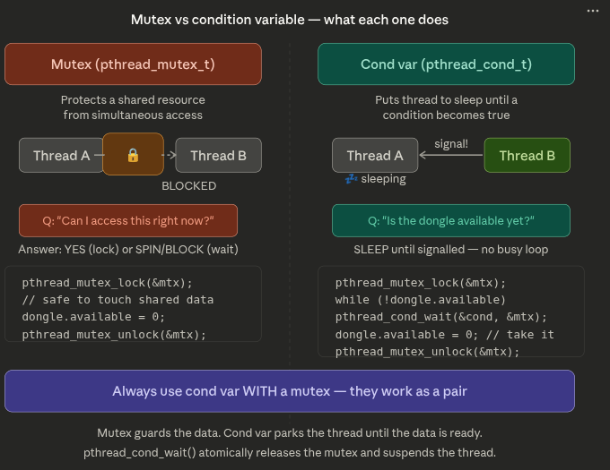
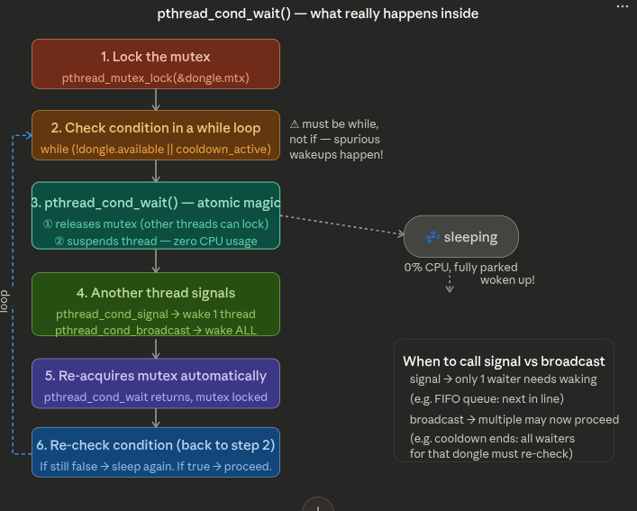

# Threads, Data Races & Mutex — Concurrency Explained

---

## 1. Threads

When you create a thread inside `main`, you are spawning a new execution flow that runs **concurrently** with the main thread. Both threads are now alive at the same time, and the CPU decides which one runs first — so the print order is **non-deterministic**.

> Important: `main()` itself **is** a thread — the "main thread." You are not creating a process, you are creating an additional thread inside the existing process.

There is one critical trap: **if `main` exits before your thread finishes, the entire process dies and kills your thread mid-execution.** This is why you must call `pthread_join` — it forces main to wait for the thread to complete before exiting.

```
THREAD LIFECYCLE
═══════════════════════════════════════════════════════

  main()
  │
  ├─── pthread_create(&t, func) ──────────────────────┐
  │                                                    │
  │   [main thread continues]          [thread func() starts]
  │   printf("main");                  printf("thread");
  │                                                    │
  │   pthread_join(t) ◄────── waits ──── thread ends  │
  │                                                    │
  └─── main exits cleanly ◄───────────────────────────┘

  WITHOUT join:
  main exits → kills thread mid-execution → undefined behavior
```

---

## 2. Data Race

A data race happens when two threads access the **same shared variable** at the same time, and at least one of them is writing.

The common misconception is that one thread "copies into the other thread's register." That is not what happens. Each thread reads the shared variable into **its own register**, modifies it locally, then writes back. The problem is that this **read → modify → write** sequence is not atomic — another thread can interrupt between the read and the write, producing a stale result.

```
SHARED VARIABLE: counter = 5
════════════════════════════════════════════════════════

  Thread A                          Thread B
  ─────────────────────────         ─────────────────────────
  READ counter → reg_A = 5
                                    READ counter → reg_B = 5
  ADD 1 → reg_A = 6
  WRITE reg_A → counter = 6
                                    ADD 1 → reg_B = 6
                                    WRITE reg_B → counter = 6

  RESULT: counter = 6  ← WRONG, expected 7 !
  One increment was silently LOST.
```

The increment from Thread A was overwritten by Thread B's stale write. No crash, no error message — just a wrong value. This is what makes data races so dangerous.

---

## 3. Mutex

A mutex (mutual exclusion) is a lock that protects a **critical section** — a block of code that must not be executed by more than one thread at a time.

Your bathroom lock analogy is correct: once someone is inside and the lock is turned, nobody else can enter. They do not skip or fail — they **block and wait** at the door until the lock is released.

```
MUTEX IN ACTION
════════════════════════════════════════════════════════

  SHARED: counter = 5
  MUTEX:  🔓 unlocked

  Thread A                          Thread B
  ─────────────────────────         ─────────────────────────
  pthread_mutex_lock(&m)
  🔒 LOCKED                         pthread_mutex_lock(&m)
                                    ⏳ BLOCKED — waiting...
  READ counter = 5
  ADD 1
  WRITE counter = 6
  pthread_mutex_unlock(&m)
  🔓 UNLOCKED
                                    ✅ UNBLOCKED — got lock
                                    🔒 LOCKED
                                    READ counter = 6
                                    ADD 1
                                    WRITE counter = 7
                                    pthread_mutex_unlock(&m)
                                    🔓 UNLOCKED

  RESULT: counter = 7  ✅ CORRECT
```

The mutex serializes access to the shared variable. Each thread gets a clean, uninterrupted read → modify → write cycle.

---

## 4. Full Picture — Codexion / Dining Coders

---

## 5. Mutex vs. Condition Variable

It is crucial to understand the difference between a Mutex and a Condition Variable (Cond Var), as they serve different but complementary purposes.



*   **Mutex (`pthread_mutex_t`)**: Protects a shared resource from simultaneous access. It acts like a simple lock. If you ask "Can I access this right now?", the answer is either YES (you lock it) or NO (you block/spin until it's free).
*   **Condition Variable (`pthread_cond_t`)**: Used to put a thread to sleep until a specific condition becomes true. Instead of constantly locking and unlocking a mutex to check if a rule is met (which wastes CPU), a Cond Var parks the thread (0% CPU) until another thread sends a "signal" that something changed.

> **Golden Rule**: Always use a condition variable WITH a mutex. The mutex guards the data, while the condition variable safely parks the thread until the data is ready.

---

## 6. How `pthread_cond_wait()` Works Internally

The lifecycle of waiting for a condition is a specific sequence to avoid subtle concurrency bugs (like spurious wakeups).


3.  **The Wait (`pthread_cond_wait`)**: This function does atomical magic: it *releases the mutex* so others can work, and *suspends the thread* putting it to sleep.
4.  **Signal/Broadcast**: Another thread does its job, changes the condition, and calls `pthread_cond_signal` (wakes 1 thread) or `pthread_cond_broadcast` (wakes all waiting threads).
5.  **Re-acquire Mutex**: The sleeping thread wakes up and *automatically re-locks the mutex* before returning from `pthread_cond_wait()`.
6.  **Re-check Condition**: Because of the `while` loop, it loops back to step 2 to ensure the available resource wasn't stolen by someone else between wake-up and locking. If the condition is true, it exits the loop and proceeds safely!

This project is a dining philosophers variant. Coders share USB dongles. Compiling requires grabbing two dongles simultaneously — one in each hand. Each dongle sits between two neighbors and is protected by a mutex.

```
CODEXION — FULL SCHEMA
════════════════════════════════════════════════════════

               [Quantum Compiler]
                      ▲
           ┌──────────┴──────────┐
       Coder 0               Coder N-1
        (thread)              (thread)
          │     ╲           ╱     │
          │   dongle[0]  dongle[N-1]
          │                       │
       Coder 1               Coder 2
       (thread)              (thread)

  Each coder NEEDS 2 dongles to compile.
  Each dongle is shared between 2 neighboring coders.
  Each dongle is protected by its own mutex.

CODER LIFECYCLE:
──────────────────────────────────────────
  while (not burned out):
    ┌─────────────┐
    │  COMPILING  │  ← lock LEFT dongle + lock RIGHT dongle
    └──────┬──────┘
           ▼
    ┌─────────────┐
    │  DEBUGGING  │  ← no dongles needed
    └──────┬──────┘
           ▼
    ┌──────────────┐
    │ REFACTORING  │  ← no dongles needed
    └──────┬───────┘
           └──────► back to COMPILING (or BURNOUT if waited too long)

DANGER ZONES:
──────────────────────────────────────────
  ❌ DEADLOCK    — All coders pick up LEFT dongle simultaneously.
                   Everyone waits for RIGHT. Nobody moves. Forever.

  ❌ DATA RACE   — Two coders try to grab the same dongle at the same
                   time without a mutex. Both think they have it.

  ❌ STARVATION  — One coder never gets both dongles. Burns out.

  ✅ MUTEX       — Each dongle protected by a mutex. Only one coder
                   can hold it at a time. Others block and wait.
```

---

## 5. Summary of Corrections

| Concept | Common Mistake | Correct Understanding |
|---|---|---|
| Thread creation | "main creates the process" | main **is** a thread; `pthread_create` spawns a new thread inside the same process |
| Thread order | Output order is random | Yes — but you must `pthread_join` or main kills the thread on exit |
| Data race mechanism | "copies into the other thread's register" | Each thread reads into its **own** register; the stale write overwrites the other's result |
| Data race consequence | "data gets deleted" | No deletion — one update is silently **lost**, value is wrong |
| Mutex behaviour | "stops threads from overlapping in any way" | Protects a specific **critical section**; blocked threads **wait**, they do not fail or skip |
